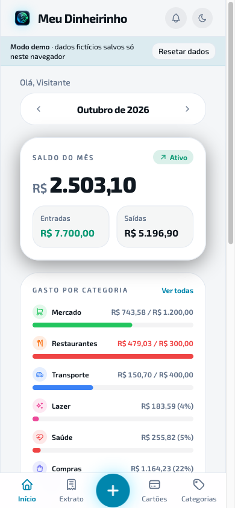
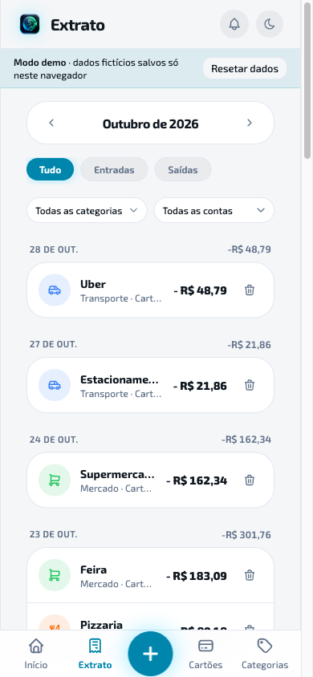
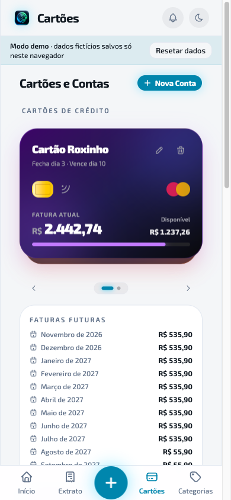
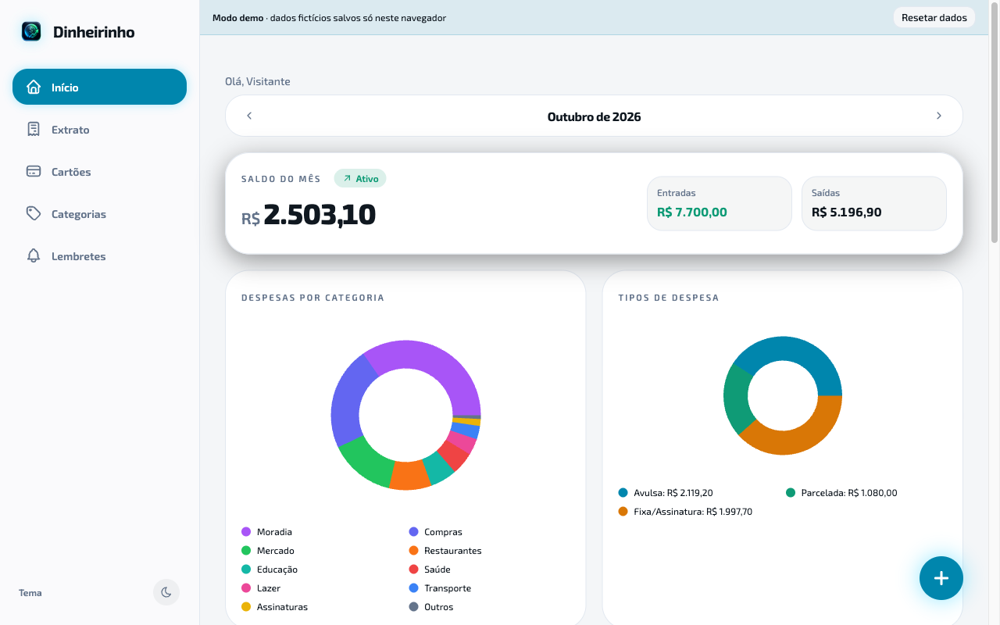

# Meu Dinheirinho

App de controle financeiro pessoal: entradas e saídas, cartão de crédito com fatura e limite, compras parceladas, gastos fixos e lembretes. É um PWA que você instala no iPhone pelo Safari e hospeda você mesmo (self-hosted, single-user).

**[▶ Abrir a demo](https://meu-dinheirinho-demo.vercel.app)**: roda inteira no navegador, com dados fictícios; nada sai do seu dispositivo.

<p>
  
  
  
</p>



## Funcionalidades

- **Lançamentos** de receitas e despesas por conta (conta corrente, dinheiro, cartão) e categoria.
- **Cartões de crédito** em carrossel estilo carteira, com fatura atual, faturas futuras e limite disponível.
- **Compras parceladas**: as parcelas são geradas automaticamente e o centavo do arredondamento vai para a última.
- **Gastos fixos e assinaturas**, gerados mês a mês; ao cancelar, o histórico é preservado.
- **Metas mensais por categoria**, com alerta quando são estouradas.
- **Lembretes** de contas a pagar e a receber, via Web Push e/ou Discord.
- **Face ID / Touch ID** (WebAuthn) para reabrir o app sem digitar a senha.
- **Uso offline (leitura)** e tema claro/escuro.

## Stack

| | |
|---|---|
| Backend | Node 24, Express, TypeScript, Prisma 7, SQLite |
| Web | Vite, React 19, TypeScript, TanStack Query, shadcn/ui, Tailwind, `vite-plugin-pwa` |
| Infra | Docker Compose (dev), Coolify (backend), Vercel (web), GitHub Actions |

## Rodando localmente

Pré-requisitos: Docker e Docker Compose.

```bash
cp backend/.env.example backend/.env   # defina AUTH_PASSWORD e AUTH_TOKEN_SECRET
cp web/.env.example web/.env
docker compose build
# Primeira vez: gera o client do Prisma e cria o banco SQLite (backend/prisma/dev.db)
docker compose run --rm --no-deps api sh -c "pnpm prisma generate && pnpm prisma migrate deploy"
docker compose up
```

- Web: http://localhost:5173 (entre com a `AUTH_PASSWORD`)
- API: http://localhost:3000

Ao atualizar o repositório (`git pull`), rode de novo o comando da primeira vez para aplicar migrations novas. Para mudar o schema: `docker compose exec api pnpm prisma migrate dev --name <nome>`.

### Só a demo (sem backend)

```bash
cd web && pnpm install && pnpm dev:demo
```

## Variáveis de ambiente

**Backend** (`backend/.env`):

| Variável | Obrigatória | Descrição |
|---|---|---|
| `DATABASE_URL` | sim | Caminho do SQLite, ex. `file:./prisma/dev.db` |
| `AUTH_PASSWORD` | sim | Senha de login (single-user) |
| `AUTH_TOKEN_SECRET` | sim | Segredo para assinar tokens, gere com `openssl rand -base64 32` |
| `AUTH_USER_NAME` | não | Nome da saudação "Olá, {nome}" |
| `WEBAUTHN_RP_ID` / `WEBAUTHN_RP_NAME` / `WEBAUTHN_ORIGIN` | sim | Face ID/Touch ID; precisam bater com o domínio do **frontend** |
| `REMINDERS_TZ` | não | Fuso dos lembretes (padrão `America/Sao_Paulo`) |
| `WEB_APP_URL` | não | URL pública do web, usada nos links das notificações |
| `DISCORD_WEBHOOK_URL` | não | Webhook para lembretes no Discord |
| `VAPID_PUBLIC_KEY` / `VAPID_PRIVATE_KEY` / `VAPID_SUBJECT` | não | Web Push, gere com `npx web-push generate-vapid-keys` |
| `PORT` / `NODE_ENV` | não | Padrão `3000` / `development` |

**Web** (`web/.env`):

| Variável | Descrição |
|---|---|
| `VITE_API_URL` | URL do backend (usada no build) |

## Deploy

O guia completo de primeira configuração (backend no Coolify, web na Vercel, pipeline do GitHub Actions e projeto da demo) está em [`docs/deployment.md`](docs/deployment.md).

## Instalando no iPhone

Abra o app no Safari → Compartilhar → **Adicionar à Tela de Início**. Pontos de atenção:

- **Single-user**: cada instância tem uma senha só, sem cadastro.
- **Face ID/Touch ID** exige HTTPS e o domínio real (não funciona por IP da rede local).
- **Push** só funciona no app instalado, a partir do iOS 16.4, e com um build de produção.

Detalhes em [`docs/web-architecture.md`](docs/web-architecture.md).

## Documentação

- [`docs/api.md`](docs/api.md): referência da API
- [`docs/architecture.md`](docs/architecture.md): decisões do backend
- [`docs/web-architecture.md`](docs/web-architecture.md): decisões do web (PWA, auth, offline, modo demo)

## Licença

[MIT](LICENSE)
